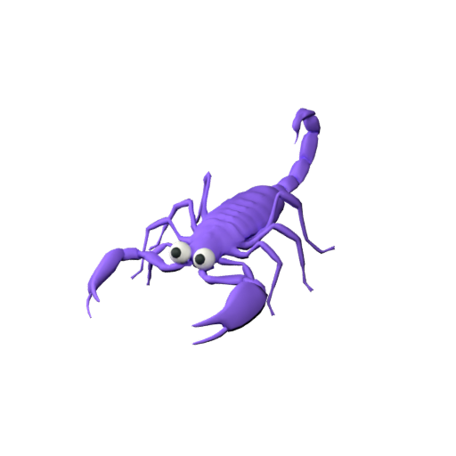
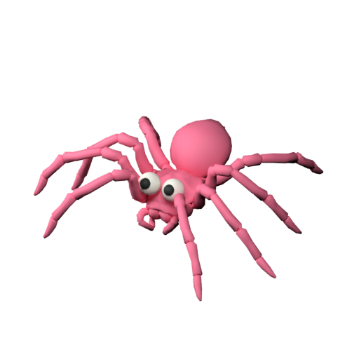

# Rigged treasure companions

Joshua explicitly requested the rigged beasts and **no testing** for this change. The additions are private family treasures, selectable in the existing Make and parent hide flows and revealed from the existing chest. They add no enemies, attacks, rarity, directions, or public presence. **We found it** is unchanged.

## Included

| App name / id | Original title / author | Animation and adaptation |
|---|---|---|
| Buddy Rex / `t-rex` | Rigged T-Rex Fabulous — TAREK SAAD | Original skeleton and opening pose; newly keyed gentle head-and-tail greeting instead of the source's long performance. Green tintable body and oversized eyes. |
| Scooter the Scorpion / `scorpion` | Scorpion — anthonyvanoo | Only `Idle`, played at 0.65 speed; no Attack, Defend, Death or Walk clips. Purple toy body and oversized eyes. |
| Button the Spider / `spider` | hi-fi-spider — jonmariano21 | `walk cycle` at 0.3 speed, in place; no circular travel. Pink body, oversized eyes, fewer polygons and no hair cards. |

Every source's embedded `asset.extras` supplies the exact title, author, profile, source and CC-BY-4.0 license. The converted body is tintable; eyes and pupils stay readable in every color. The full attribution and adaptation statements are in `manifest.json` and are shown offline under Grown-ups → Settings → Treasure makers & credits. No source textures ship.

- [Rigged T-Rex Fabulous](https://sketchfab.com/3d-models/rigged-t-rex-fabulous-4083ead8f9aa49b5b10407717bf6f60a), [TAREK SAAD](https://sketchfab.com/Tarek.Saad.Khalifa)
- [Scorpion](https://sketchfab.com/3d-models/scorpion-4c0fd62d33ab4d2592ee0a1d985a480d), [anthonyvanoo](https://sketchfab.com/anthonyvanoo)
- [hi-fi-spider](https://sketchfab.com/3d-models/hi-fi-spider-ff8a4433a5d449a3a0fc54989185a024), [jonmariano21](https://sketchfab.com/jonmariano21)
- All three: [Creative Commons Attribution 4.0](https://creativecommons.org/licenses/by/4.0/).

The scorpion and spider are presented as small, silly toy companions. Their anatomy is still recognizable; whether Emmanuel enjoys them remains a family judgment, not a claim from an unperformed play session.

## Excluded

| Source | Why it is not bundled |
|---|---|
| `snake_attack_animations_multiple.glb` — Imagigoo | Its single combined `Animation` is not separated into a clearly safe idle. Leave out the attack presentation. |
| `cartoon_flesh-eating_plant_with_animations.glb` — Jungle Jim | Only `Armature\|Attack1` and `Armature\|Roar`; biting mouth is a poor fit for this first companion set. |
| `war_dinosaur_-_rigged.glb` — Lezalit | No animation clips despite its rigged name; combat presentation. |
| `banana_tree.glb` — DJMiddi | No animation clips; scenery rather than a creature. |
| `jungle_tree.glb` — kobaltsecond6c7d6150917a4267 | No animation clips; scenery rather than a creature. Author name above is the exact embedded value. |
| `deathvader*`, `distortus_rex`, `jurassic_world_mosasaurus`, `rigged_mosasaurus_lego`, `scorpion/` FBX, every Demogorgon asset | Explicitly prohibited. No imports or derivatives. |
| `fluffy unicorn.glb`, `super lobster.glb` | On hold pending Joshua's confirmation of Tripo commercial terms. |

Original sources remain recoverable from `v1-web-final` if the web directory moves or is retired.

## Integration and design review

`import-beasts.py` uses Blender 4.5 USD export with `export_animation=True` and `export_armatures=True`, retaining UsdSkel joints, skin weights, bind transforms and time samples. Each USDZ has one clip, so the app cannot accidentally select an attack. The exporter rejects files above 2 MB. The importer keeps the original nine models and stable IDs. The original model builder also preserves imported manifest entries.

`IdleMotionPlayer` starts the baked clip once and loops it on its owning entity. Make previews, chest reveals and collected-treasure views use it. Less motion / iOS Reduce Motion keep the creature still. Get ready requires an available animation for skeletal entries, in addition to loading the model.

The source review covered the app shell, hunt, setup, Make, collection and reveal against the design branch's screen markup. Existing forest backgrounds, gold `#D4A24C`, cyan `#7FE3F0`, large picture choices, spoken Make prompts and the 56-point parent override already fit the product rules. This change bundles Barlow Condensed ExtraBold, adds its license to credits, and increases collection names from 11 to 14 points with roomier tiles. It avoids importing the mockups' rarity, arrows, public crew features or prohibited reference art.

## Evidence and limits

These are conversion renders, **not simulator screenshots**:

| Buddy Rex | Scooter | Button |
|---|---|---|
|  |  |  |

The converter reports skeletal clips and sub-2 MB output. Compilation is separate from testing. No unit/UI tests, app walkthrough, simulator launch, phone installation, `Entity.availableAnimations` runtime inspection, or device animation/performance checks were run, following Joshua's latest instruction. New catalog tests are provided for CI to exercise actual RealityKit loads, cached clones, animation availability, file sizes, and complete manifest-driven credits. Passing runtime behavior is not asserted here.
