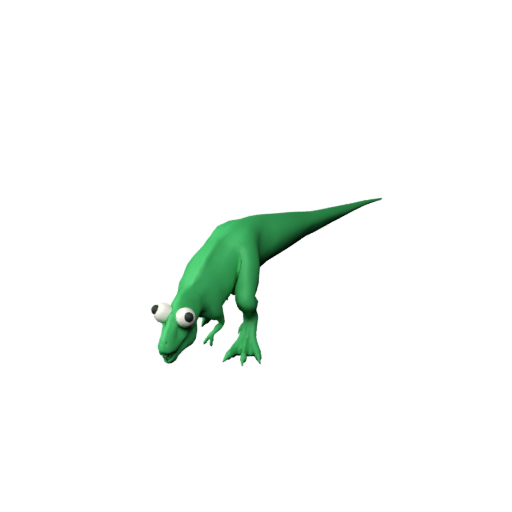

# Rigged treasure companions

Joshua explicitly requested the rigged beasts and **no testing** for this change. The additions are private family treasures, selectable in the existing Make and parent hide flows and revealed from the existing chest. They add no enemies, attacks, rarity, directions, or public presence. **We found it** is unchanged.

## Included

| App name / id | Original title / author | Animation and adaptation |
|---|---|---|
| Buddy Rex / `t-rex` | Rigged T-Rex Fabulous — TAREK SAAD | Original skeleton and opening pose; newly keyed gentle head-and-tail greeting instead of the source's long performance. Green tintable body and oversized eyes. |
| Scooter the Scorpion / `scorpion` | Scorpion — anthonyvanoo | Only `Idle`, played at 0.65 speed; no Attack, Defend, Death or Walk clips. Purple toy body and oversized eyes. |
| Button the Spider / `spider` | hi-fi-spider — jonmariano21 | `walk cycle` at 0.3 speed, in place; no circular travel. Pink body, oversized eyes, fewer polygons and no hair cards. |

For the three CC-BY creatures, each source's embedded `asset.extras` supplies the exact title, author, profile, source and CC-BY-4.0 license. The converted body is tintable; eyes and pupils stay readable in every color. The full attribution and adaptation statements are in `manifest.json` and are shown offline under Grown-ups → Settings → Treasure makers & credits. No source textures ship.

- [Rigged T-Rex Fabulous](https://sketchfab.com/3d-models/rigged-t-rex-fabulous-4083ead8f9aa49b5b10407717bf6f60a), [TAREK SAAD](https://sketchfab.com/Tarek.Saad.Khalifa)
- [Scorpion](https://sketchfab.com/3d-models/scorpion-4c0fd62d33ab4d2592ee0a1d985a480d), [anthonyvanoo](https://sketchfab.com/anthonyvanoo)
- [hi-fi-spider](https://sketchfab.com/3d-models/hi-fi-spider-ff8a4433a5d449a3a0fc54989185a024), [jonmariano21](https://sketchfab.com/jonmariano21)
- All three: [Creative Commons Attribution 4.0](https://creativecommons.org/licenses/by/4.0/).

The scorpion and spider are presented as small, silly toy companions. Their anatomy is still recognizable; whether Emmanuel enjoys them remains a family judgment, not a claim from an unperformed play session.

## Family-requested procedural creatures

On 15 November 2026 Joshua explicitly requested **Demogorgon, Demodog and Vine Dog**, superseding the earlier exclusion of these three for this private family build. Their source rigs and baked idle clips are preserved from commit `2b397b3cad58d17722b5bd907433863b4881c9df` on `claude/demogorgon-rig-animate-6a2474`. This records the request and source history; it does not label the characters original or CC-BY.

| ID | Rig | iPhone adaptation |
|---|---|---|
| `demogorgon` | 56 bones | Original flower face, anatomy colors and Idle; simplified mesh and no browser wrinkle maps |
| `demodog` | 46 bones | Original four-legged rig and Idle; same material and size treatment |
| `vine-dog` | 58 bones | Original six-legged rig, vine colors, closed snout and Idle; same size treatment |

`tools/export-flower-beasts.mjs` reproduces the intermediate GLBs from pinned source without switching branches. `tools/convert-rigged-beasts.py` converts them to USDZ and adds the manifest records. The USDZs are 1,705,055 bytes (Demogorgon), 1,673,088 bytes (Demodog), and 1,675,111 bytes (Vine Dog). Each has one UsdSkel animation, and is available in the live picker, previews, reveal and collection detail through the shared model code. Source details appear in the credits screen from `provenance`, separate from the CC-BY license credits.

See [RIGGED_BEAST_WORKFLOW.md](RIGGED_BEAST_WORKFLOW.md) for adding future converted GLBs, native Blender rigs, or directly authored iPhone USDZs. No future creatures are initiated by this change. Simulator and signed device builds succeeded. The expanded app installed and launched on Joshua’s iPhone on 15 November 2026; visible playback has not been inspected. No local tests were run.

## Mulligan — family-requested iPhone-first beast

Joshua requested **Mulligan** on 15 November 2026 from three supplied views of the same toy, with
standard looping idle motions. The new Blender source follows its olive hunch, long forelimbs,
pink snout/lower limbs, yellow teeth and claws, and black branching back/rump ridges. It is a
character adaptation for the private family build, not a claim of original character or photo
rights, and is not labeled CC-BY. Manifest provenance feeds the existing in-app credits.

`mulligan` adds one 678,051-byte USDZ, a transparent 512 × 512 thumbnail and a 30-joint skin. Its
single six-second `GentleIdle` combines breathing, head turns, jaw movement, planted-foot weight
shifts and toe flex. The converter records 12,000 triangles, 145 joint samples and 29 changing
joints with a stationary Root. Authored colors are retained. The enum/manifest additions reuse
the shared live picker, preview, chest/detail animation player, Less motion and readiness checks.
The head-shape revision narrows the skull by 45% and the lower jaw by 50% to match Joshua's
references, including the lips, teeth, mouth lining and forehead ridges; it retains the same rig.

The [complete source and art renders](Sources/Mulligan/README.md) include the deterministic
authoring script, `.blend`, source/reference records, export metadata and idle preview. Simulator
and signed iPhone builds succeeded. No local tests or app walkthroughs ran. No app installation,
launch or observed RealityKit playback is claimed for this change.

## Excluded

| Source | Why it is not bundled |
|---|---|
| `snake_attack_animations_multiple.glb` — Imagigoo | Its single combined `Animation` is not separated into a clearly safe idle. Leave out the attack presentation. |
| `cartoon_flesh-eating_plant_with_animations.glb` — Jungle Jim | Only `Armature\|Attack1` and `Armature\|Roar`; biting mouth is a poor fit for this first companion set. |
| `war_dinosaur_-_rigged.glb` — Lezalit | No animation clips despite its rigged name; combat presentation. |
| `banana_tree.glb` — DJMiddi | No animation clips; scenery rather than a creature. |
| `jungle_tree.glb` — kobaltsecond6c7d6150917a4267 | No animation clips; scenery rather than a creature. Author name above is the exact embedded value. |
| `deathvader*`, `distortus_rex`, `jurassic_world_mosasaurus`, `rigged_mosasaurus_lego`, `scorpion/` FBX | Explicitly prohibited. No imports or derivatives. |
| `fluffy unicorn.glb`, `super lobster.glb` | On hold pending Joshua's confirmation of Tripo commercial terms. |

Original sources remain recoverable from `v1-web-final` if the web directory moves or is retired.

## Integration and design review

`import-beasts.py` uses Blender 4.5 USD export with `export_animation=True` and `export_armatures=True`, retaining UsdSkel joints, skin weights, bind transforms and time samples. Each USDZ has one clip, so the app cannot accidentally select an attack. The exporter rejects files above 2 MB. The importer keeps the original nine models and stable IDs. The original model builder also preserves imported manifest entries.

`IdleMotionPlayer` starts the baked clip once and loops it on its owning entity. Make previews, chest reveals and collected-treasure views use it. Less motion / iOS Reduce Motion keep the creature still. Get ready requires an available animation for skeletal entries, in addition to loading the model.

The source review covered the app shell, hunt, setup, Make, collection and reveal against the design branch's screen markup. Existing forest backgrounds, gold `#D4A24C`, cyan `#7FE3F0`, large picture choices, spoken Make prompts and the 56-point parent override already fit the product rules. This change bundles Barlow Condensed ExtraBold, adds its license to credits, and increases collection names from 11 to 14 points with roomier tiles. It avoids importing the mockups' rarity, arrows, public crew features or prohibited reference art.

## Evidence and limits

These are conversion renders, **not simulator screenshots**:

| Buddy Rex | Scooter | Button |
|---|---|---|
|  |  |  |

The converter reports skeletal clips and sub-2 MB output. Simulator and signed device builds succeeded. `ios/scripts/device.sh` installed the updated app on Joshua's iPhone (iPhone 17 Pro Max); its launch attempt was denied because the phone was locked. Unlock the phone and tap Tatchamashay to open it. No unit/UI tests, app walkthrough, simulator launch, `Entity.availableAnimations` runtime inspection, or device animation/performance checks were run, following Joshua's latest instruction. New catalog tests are provided for CI to exercise actual RealityKit loads, cached clones, animation availability, file sizes, and complete manifest-driven credits. Passing runtime behavior is not asserted here.
