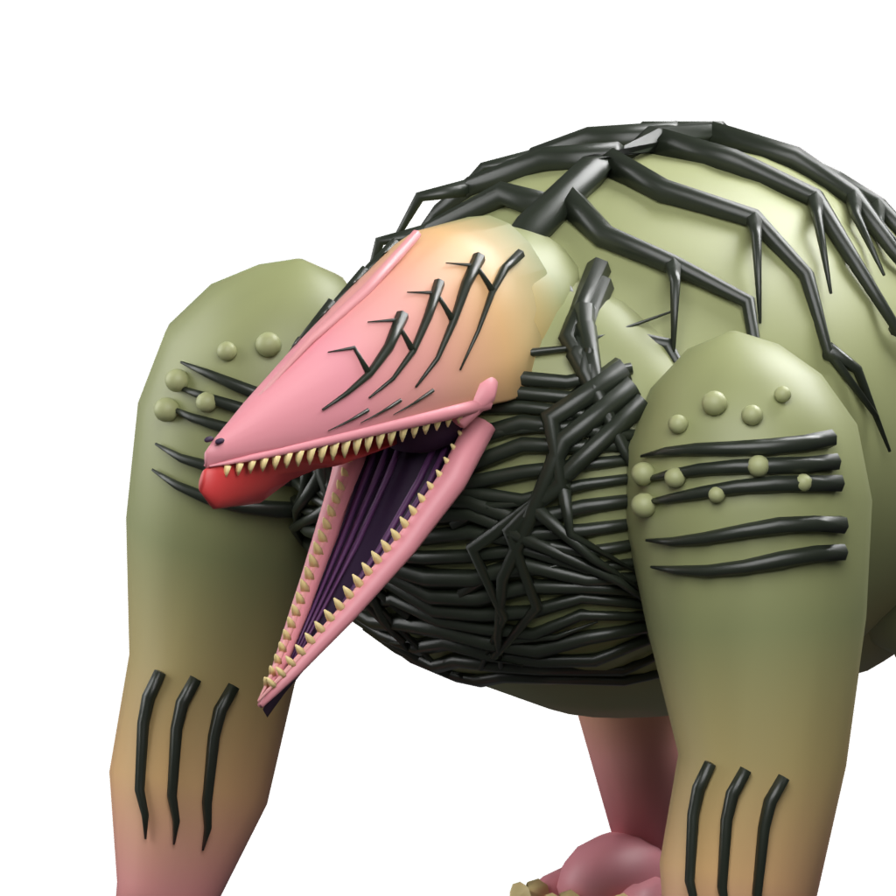

# Mulligan source

Joshua requested **Mulligan** on 15 November 2026: “use standard idle looping and all motions.”
All five supplied toy photographs describe this one creature. This is a new iPhone-first Blender
model and rig made by Codex from those references, rather than an imported or archived mesh.

The adaptation keeps the reference's hunched olive body, long forelimbs and shorter rear legs,
pink snout and extremities, yellow teeth/claws, narrow eyeless head and dark branching ridges across the
back and rump. It has four limbs and no tail. The material gradient is preserved; whole-body
tinting is disabled so selecting an app color does not erase the authored markings.

The underlying character and reference photographs are not represented as original designs or
CC-BY material. Joshua supplied the photographs for this private family build; their original
photographer/manufacturer and source URLs were not supplied. `source-record.json` records the
request, filenames, reference-image hashes, generator revision and tool version. Reference photos
are not shipped in the app or copied into this repository. The manifest's provenance is displayed
by the existing Treasure makers & credits screen.

## Files and reproduction

- `build-mulligan.py`: complete deterministic authoring recipe, seed 714, with no external assets.
- `mulligan.blend`: source mesh, skin weights and 30-joint deforming armature.
- `authoring-record.json`: source geometry and animation metadata.
- `delivery-record.json`: the final packed USDZ's size, hash, geometry and joint-sample metadata.
- `render-mulligan.py`, `idle-preview.gif`, `rear-preview.png`, `front-preview.png`,
  `side-preview.png` and the 1024-pixel `detail-preview.png`: source art review; not app captures.

Generator revision 3 follows Joshua's additional open-mouth references. The skull is a narrow
tapering wedge, and two slim mandibular rails meet at a single pointed chin, replacing the broad
lower plate. The mouth has 88 fine teeth, a concave violet lining and folds, a curved red tongue,
small nostril recesses and finer facial branches. The chest has 19 irregular woven cord layers
and larger branching strands; rounded deltoids carry 20 raised nodules and wrapping creases.
Forearm markings and subtle skin mottling add detail without texture downloads.

Run with Blender 4.5 from the repository root:

```sh
blender --background --factory-startup --python ios/Assets/Sources/Mulligan/build-mulligan.py
blender --background --factory-startup --python ios/Assets/tools/convert-rigged-beasts.py -- mulligan
blender --background --factory-startup --python ios/Assets/Sources/Mulligan/render-mulligan.py
ffmpeg -framerate 6 -pattern_type glob -i 'ios/Assets/tools/.build/mulligan-preview/idle-*.png' \
  -filter_complex 'split[a][b];[a]palettegen=reserve_transparent=1:stats_mode=diff[p];[b][p]paletteuse=dither=bayer:bayer_scale=5' \
  -loop 0 -y ios/Assets/Sources/Mulligan/idle-preview.gif
```

The source `Idle` action is baked at 24 fps, frames 1–145: one six-second, in-place loop with
breathing, head turn/nod, jaw opening, weight shifts and toe flex. The characteristic open jaw
eases between approximately 39 and 49 degrees. The generator solves planted wrists/ankles offline,
preserving each limb's bind roll, and keys the final joint poses. There are no object-transform animation,
runtime IK, drivers or physics dependencies. The shared converter exports `GentleIdle`, normalizes
to a 0.32 m longest dimension, Y-up/meters/+Z-facing with feet on the ground. The detailed source
has 21,598 triangles within a 22,000-triangle budget; the 2,000,000-byte delivery limit is unchanged.

## Delivery evidence

The shared converter accepted the final **1,101,448-byte** USDZ: one skeleton, 30 joints, one clip,
145 rotation samples and 29 changing joints; Root is stationary. The transparent thumbnail is
512 × 512. Source pose renders were inspected from the front and rear, including the open jaw,
mouth interior, shoulder/chest detail and moving head/jaw poses.
This is art/conversion evidence, not observed RealityKit playback.

Simulator compilation and signed iPhone compilation both succeeded. No local tests, UI tests,
walkthroughs or runtime animation checks were run. These authoring checks predate phone delivery. See [PR #24](https://github.com/JoshuaBroggi/tatchamashay/pull/24)
for the latest installation/launch result; the art renders alone do not prove phone playback. Existing generic
catalog coverage already enumerates every `BuiltInModel` and skeletal manifest entry for CI.





